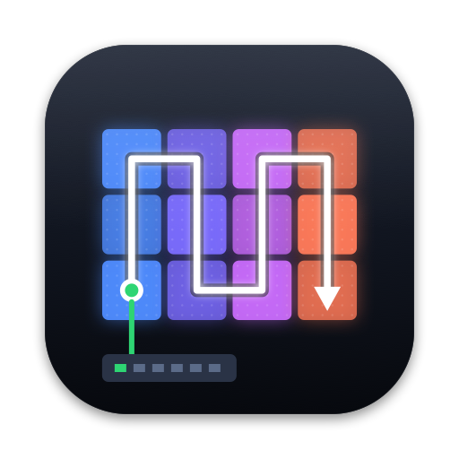
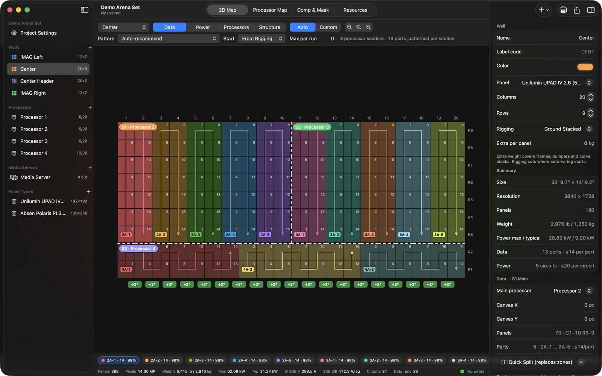
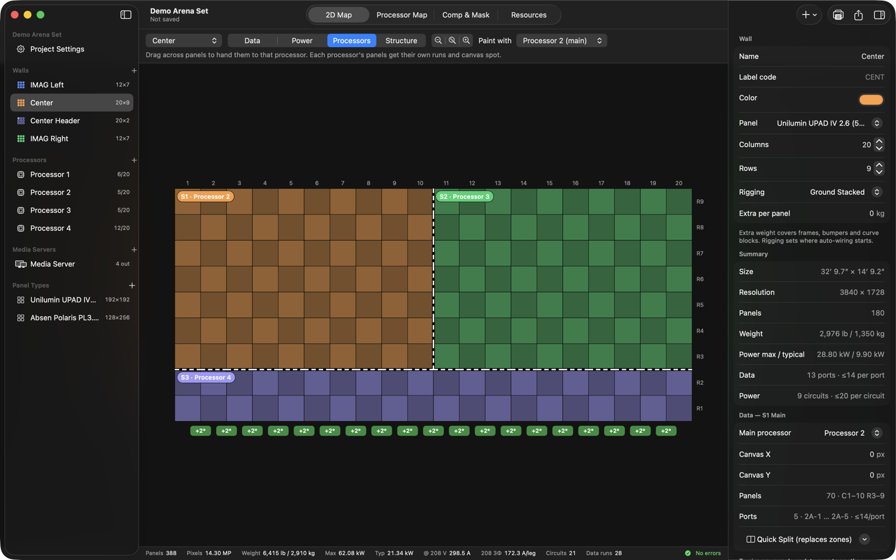
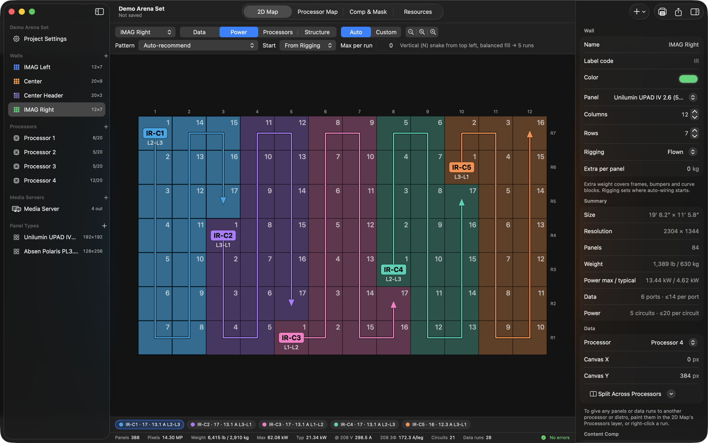
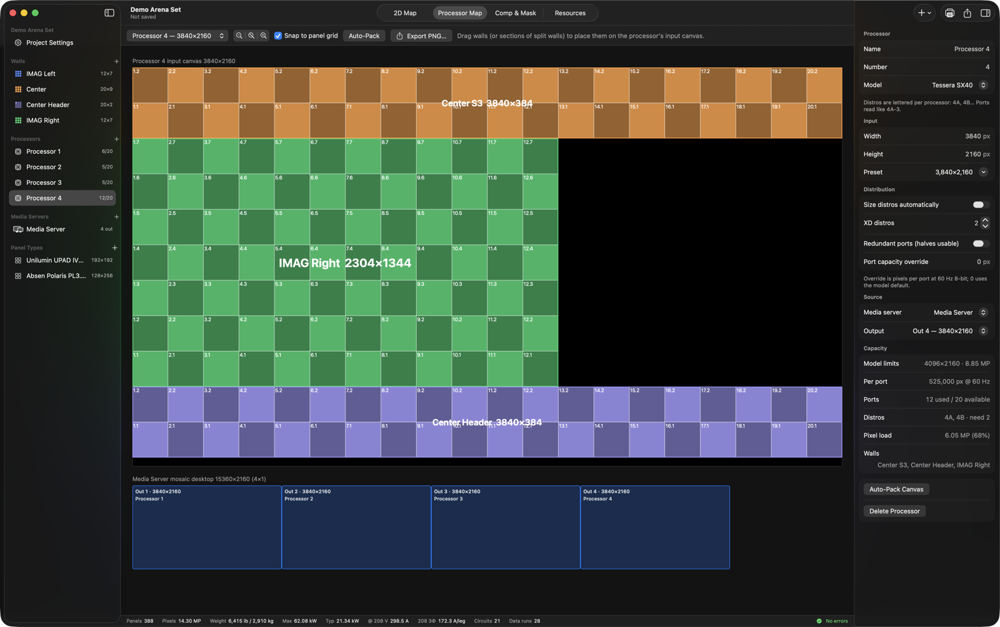
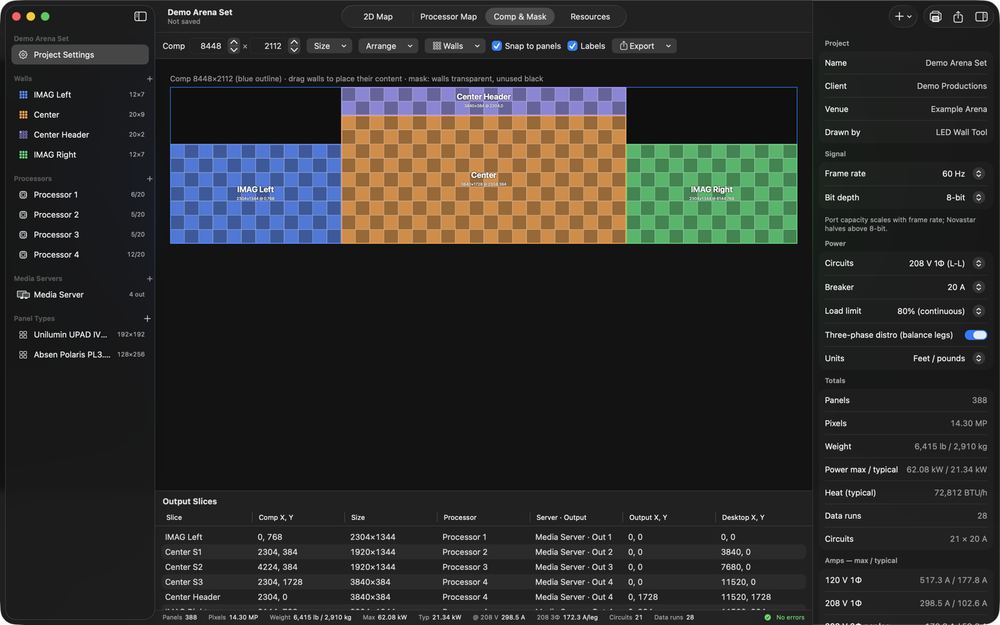
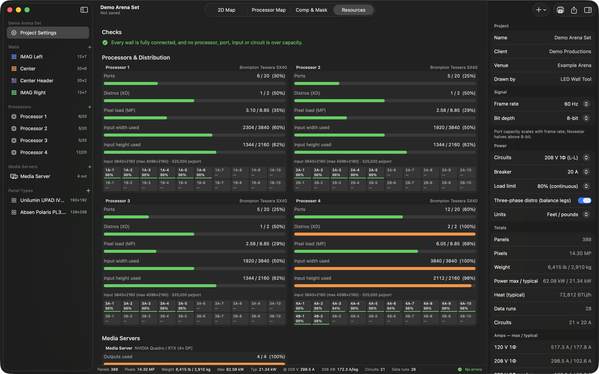
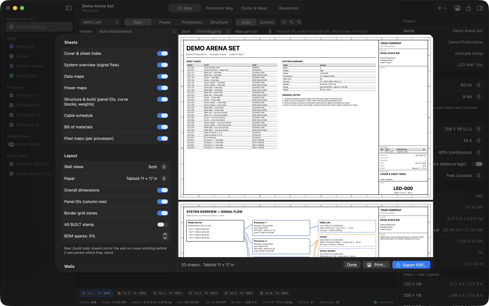
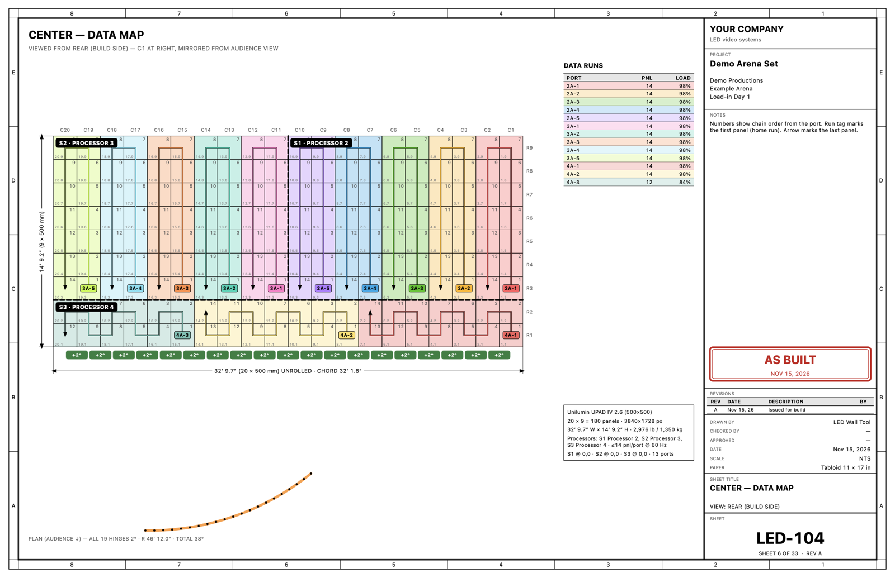
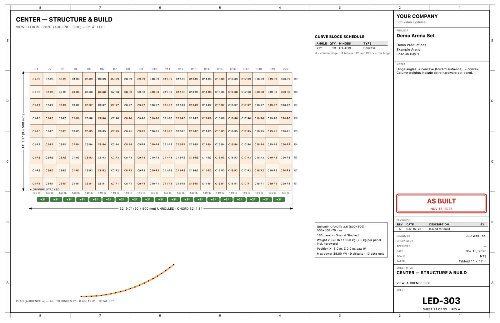

<p align="center">
  
</p>

<h1 align="center">LED Wall Tool</h1>

<p align="center">
  Plan LED wall data and power before load-in, from one wall to a full arena set.<br>
  A native macOS app for touring and event video crews.
</p>

<p align="center">
  <a href="../../releases/latest"><b>Download for macOS</b></a> ·
  <a href="docs/getting-started.md">Getting Started</a> ·
  <a href="docs/README.md">Documentation</a>
</p>



## What it does

LED Wall Tool turns a set of walls, processors and a media server into the paperwork a crew needs on show day: data maps, power maps, build sheets, pixel maps and a content comp. It also checks that nothing is over capacity before you get there.

- **Many walls, many processors.** Lay out IMAG, center walls, headers and wings. Use as many processors as you need, named the way crews say them: processor **1**, distros **1A** and **1B**, port **1A-3**.
- **Brompton and Novastar built in.** Tessera SX40 with XD, plus S8, S4, VX4S, VX6s, NovaPro UHD Jr and MX20/30/40 Pro. Panel library includes Unilumin UPAD IV, Absen Polaris and A3 Pro, ROE and Revelux.
- **Auto wiring, or wire it yourself.** Data and power runs are recommended automatically (N, S/zig-zag, Z, straight, U, C, center-out). Switch any wall to custom and drag runs by hand.
- **Split a wall any way.** Paint panels onto other processors: down the middle, the bottom two rows, a single column. Each piece gets its own runs, ports and canvas position.
- **Curves, corners and headers.** Concave and convex curves, per-hinge curve blocks, corner wings and tilted headers that follow the wall below.
- **Catch problems early.** Port pixel load, distro count, processor pixel capacity, input resolution, canvas fit, media server outputs and circuit load are all checked, with the fix spelled out.
- **Power and weight.** Circuits sized to your breaker and derate, amps at 120, 208, 230 and 240 V, three-phase balancing, feeder size and weight per wall and per column.
- **As-built drawing set.** Vector PDF with a title block, revisions and sheet numbers. Audience or rear (build side) views, curve-block schedules, cable schedule, BOM and pixel maps.
- **Content comp and mask.** Lay out the whole Resolume-style comp, then export a transparent mask, a labelled template and the output slice list.

## Screenshots

| | |
|---|---|
|  |  |
| **Processors layer.** Paint any panels onto any processor. | **Power map.** Circuits sized to the breaker, with phase legs. |
|  |  |
| **Processor Map.** Place each wall on a processor's input. | **Comp & Mask.** Build the whole comp and export a mask. |
|  |  |
| **Resources.** Every capacity check, port grid and amp total. | **Drawing set export.** Choose sheets, views and paper with a live preview. |

### Drawing set

| | |
|---|---|
|  |  |

See a complete example: [demo drawing set (PDF)](docs/samples/demo-drawing-set.pdf).

## Download and install

1. Download **LEDWallTool-x.y.z-macOS.zip** from the [latest release](../../releases/latest).
2. Unzip it and drag **LEDWallTool.app** into **Applications**.
3. The first time, **right-click the app → Open → Open**. After that it opens normally.

Requires macOS 14 Sonoma or later. Runs natively on Apple Silicon and Intel.

> If macOS says the app "is damaged" or still won't open, run this once in Terminal:
>
> ```bash
> xattr -dr com.apple.quarantine /Applications/LEDWallTool.app
> ```
>
> The app is signed for local use but not yet notarized by Apple, which is why macOS asks the first time.

New to the app? Choose **File ▸ Open Demo Project** to explore a finished arena set, then read [Getting Started](docs/getting-started.md).

## Documentation

- [Getting Started](docs/getting-started.md): your first wall, processor and drawing set
- [Data and Power Wiring](docs/wiring.md): patterns, custom runs, ports and circuits
- [Processors and Splitting Walls](docs/processors.md): naming, capacity, painting zones, input canvases
- [Comp and Mask](docs/comp-and-mask.md): building the content comp for Resolume and similar
- [Drawing Sets](docs/drawings.md): sheets, audience and rear views, title block and printing
- [Checks Reference](docs/checks.md): every error and warning, and how to fix it

## Build from source

You need Xcode 15 or later and [XcodeGen](https://github.com/yonaskolb/XcodeGen).

```bash
git clone https://github.com/samandrsn/ledwalltool.git
cd ledwalltool
xcodegen generate
open LEDWallTool.xcodeproj
```

The planning engine lives in `Packages/WallKit` (no UI) and has its own tests:

```bash
cd Packages/WallKit && swift test
```

| Path | What |
|---|---|
| `Packages/WallKit/Sources/WallKit` | Catalog, model, geometry, routing, analysis, comp and schedules |
| `LEDWallTool/Views` | Sidebar, inspector, 2D map, processor map, comp, resources, export |
| `LEDWallTool/App` | App, project store, drawing set renderer, exporters |
| `tools/make-icon.swift` | Draws the app icon |

## Known limits

- Catalog figures are typical published specs. Check panels and processors against current manufacturer data before a show. Revelux entries are placeholders to fill in.
- The 3D view is hidden in this release.
