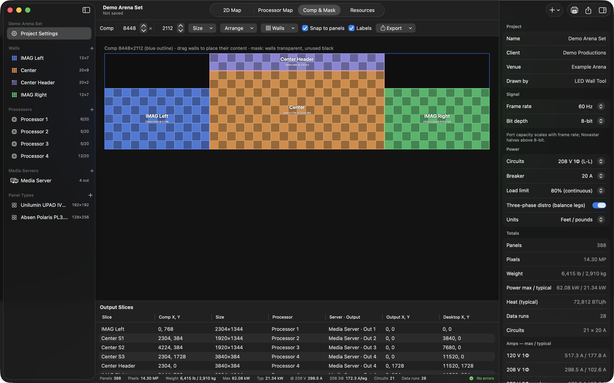
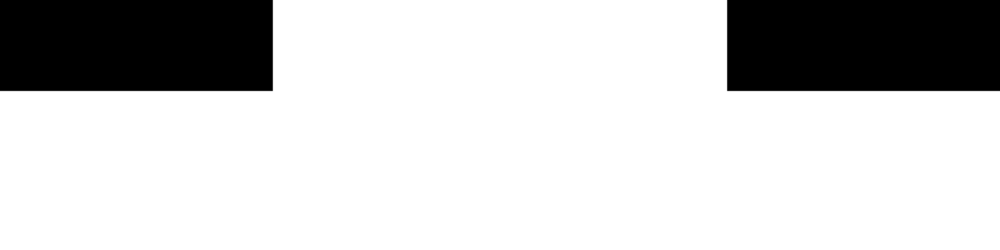

# Comp and Mask

The **Comp & Mask** workspace lays out the whole content composition (for example a Resolume Arena comp) with every wall at native pixels. From it you export a mask, a labelled template and the list of output slices.

## Laying out the comp

New walls start in an unrolled **stage layout**: headers sit above their wall, wings beside it, and groups run left to right in stage order. You can change that:

- **Arrange ▸ Stage Layout (Unrolled)** resets to the stage layout.
- **Arrange ▸ Match Media Server Outputs** places each wall where it lands on the media server's mosaic desktop.
- **Drag** a wall to move it. **Snap to panels** keeps it on the panel grid. The first drag pins every wall where it is, so others don't shift.
- **Walls** hides walls from the comp, for example ones fed from another server. The wall inspector also has **Include in comp** and Comp X/Y.

## Comp size

Type a width and height, or use the arrows beside each to grow or shrink it by one panel. **Size ▸ Fit to Walls** fits the comp to the layout, and the menu has common sizes from 1920×1080 to 15360×2160.

The comp is outlined in blue. Anything outside it is shown on grey and flagged in the toolbar.

## Exports

From the **Export** menu:

| Export | What you get |
|---|---|
| **Mask PNG** | The comp at full resolution. LED panels are transparent and everything else is black, with hard edges and cut-outs left black. Put it on the top layer of your comp. |
| **Template PNG** | The same layout with coloured panels, panel numbers, wall names, sizes and positions, for content creators. |
| **Slices CSV** | One row per wall (and per section of a split wall): comp position and size, processor, server output and position on that output and on the mosaic desktop. These are the numbers for output slices in Resolume's Advanced Output. |

The **Output Slices** table under the canvas shows the same numbers as the CSV.
