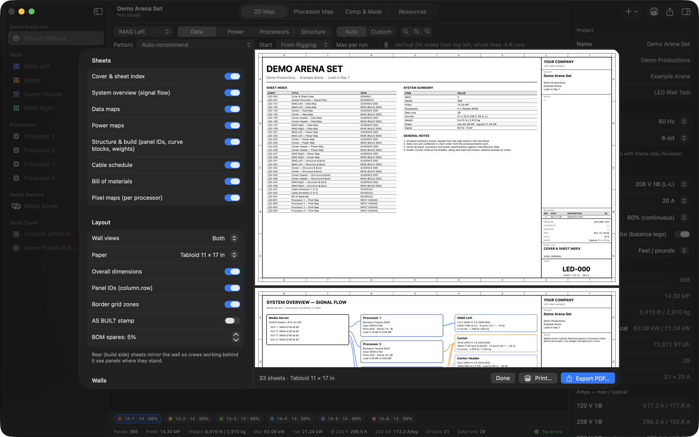
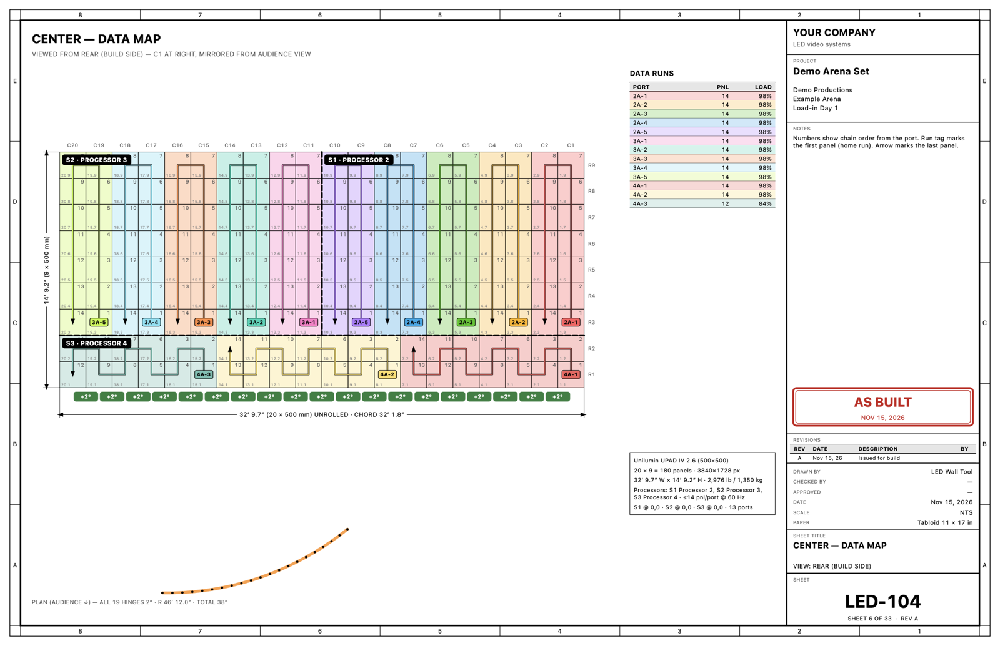
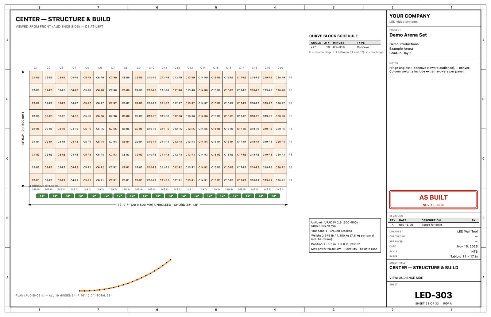

# Drawing Sets

Press **⌘E** (or the share button in the toolbar) to open the drawing set export. Options are on the left and a live preview is on the right.

The set is saved with the project, so ⇧⌘E exports again with the same settings and ⌘P prints them.

## Sheets

| Number | Sheet |
|---|---|
| LED-000 | Cover and sheet index, system summary, general notes |
| LED-001 | System overview: media server → processors and distros → walls |
| LED-1xx | Data map for each wall |
| LED-2xx | Power map for each wall |
| LED-3xx | Structure and build: panel IDs, weight per column, curve-block schedule |
| LED-4xx | Cable schedule: every data and power run, start and end panel, jumpers, load and phase |
| LED-501 | Bill of materials, with spares |
| LED-6xx | Pixel map for each processor |

Turn any group on or off under **Sheets**, and choose which walls to include under **Walls**.

## Audience and rear views

**Wall views** chooses **Audience Side**, **Rear (Build) Side** or **Both**. Rear sheets mirror the wall so column 1 is on the right, matching what a crew sees standing behind it. Every sheet says which side it shows, under the title and in the title block.

## Layout options

- **Paper:** Tabloid 11×17, ARCH C 18×24, ARCH D 24×36, A3, A1 or Letter
- **Overall dimensions:** unrolled width and chord for curved walls
- **Panel IDs:** column.row on every panel
- **Border grid zones:** numbered and lettered zones around the border
- **AS BUILT stamp:** in the title block
- **BOM spares:** percentage added to panels, cables and jumpers

## Title block

Fill in company, drawn by, checked by, approved by and show dates. Add a revision for each issue: the latest revision letter appears on every sheet. **General Notes** print on the cover.

See a full example: [demo drawing set (PDF)](samples/demo-drawing-set.pdf).
