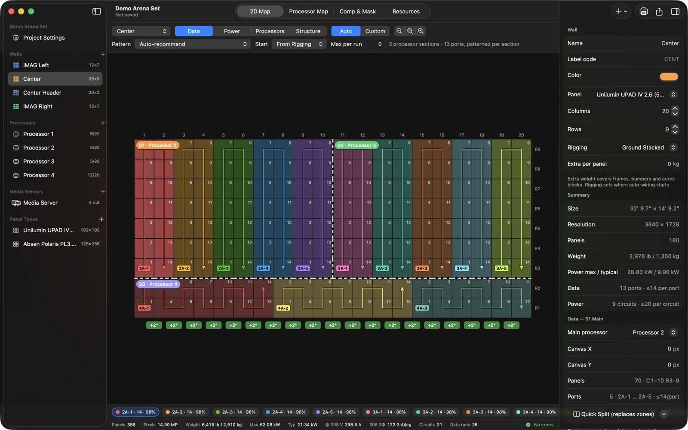

# Getting Started

This guide walks through the window and takes one wall from nothing to a printed drawing set.

## The window

- **Sidebar (left).** Project Settings, then your **Walls**, **Processors**, **Media Servers** and **Panel Types**. Click the **+** beside a heading to add one. Right-click a wall to add a header, a left or right wing, duplicate it or delete it.
- **Workspaces (top).** Switch between **2D Map**, **Processor Map**, **Comp & Mask** and **Resources**.
- **Inspector (right).** Settings for whatever is selected in the sidebar. Hide or show it with the right-most toolbar button.
- **Status bar (bottom).** Set totals: panels, pixels, weight, power, amps, circuits and data runs. The right end shows errors and warnings: hover to list them, click for the full list.

Your work is saved automatically between launches. Use **File ▸ Save** (⌘S) to keep a `.ledwall` file you can share.

## 1. Set up the project

Click **Project Settings** at the top of the sidebar (or press ⌘,).

- **Signal:** frame rate and bit depth. These set how many pixels each data port can carry.
- **Power:** circuit voltage (120, 208, 230 or 240 V), breaker size, load limit (80% continuous or 100%), three-phase balancing and units.

## 2. Add a panel type

Click **+** beside **Panel Types** and pick a panel from the library (Unilumin UPAD IV, Absen Polaris and A3 Pro, ROE, Revelux and generics). Select it to adjust pixels, size, weight, power, max panels per data port and max panels per power link.

## 3. Add a wall

Click **+** beside **Walls**. In the inspector set its name, panel, **Columns**, **Rows** and rigging (ground stacked or flown). Rigging sets which corner auto-wiring starts from.

- **Curves & Hinges:** set every column hinge at once, enter a radius, or type a list of angles. Positive is concave (toward the audience), negative is convex.
- **Placement:** attach the wall to another wall's top (a header), left or right edge (a wing or corner), or place it freely.
- **Cut-outs:** in the 2D Map's **Structure** layer, click or drag across panels to remove them.

## 4. Add a processor

Click **+** beside **Processors**. Pick the model, input resolution and number of distros. Then select your wall and choose that processor in the inspector's **Data** section.

The processor is numbered **1** and its distros are **1A** and **1B**, so the first data port reads **1A-1**. See [Processors and Splitting Walls](processors.md).

## 5. Check the wiring

Open the **2D Map**, pick the wall and switch between **Data** and **Power**. Runs are wired automatically using the recommended pattern. Change the pattern or start corner in the toolbar, or switch to **Custom** to draw runs yourself. See [Data and Power Wiring](wiring.md).

## 6. Fix anything red

Open **Resources**, or click the error count in the status bar. Every check that fails says what to change, for example "needs 22 ports but only 20 available — add distro 1C". See the [Checks Reference](checks.md).

## 7. Export the drawings

Press ⌘E to open the drawing set export. Choose the sheets, audience or rear views and paper size, fill in the title block, then **Export PDF…** or **Print…**. See [Drawing Sets](drawings.md).

## Keyboard shortcuts

| Shortcut | Action |
|---|---|
| ⌘N | New project |
| ⌘O | Open a project |
| ⌘S / ⇧⌘S | Save / Save As |
| ⌘Z / ⇧⌘Z | Undo / Redo |
| ⌘, | Project settings |
| ⌘E | Export drawing set |
| ⇧⌘E | Export drawings with the last settings |
| ⌘P | Print drawings |
| ⌥-drag | Remove panels from a custom run (2D Map) |
