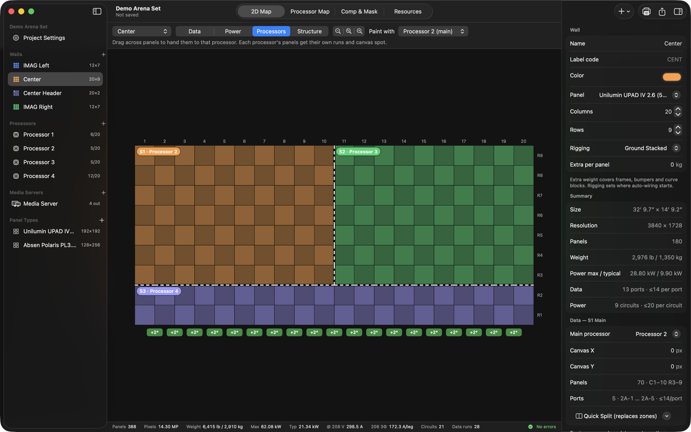
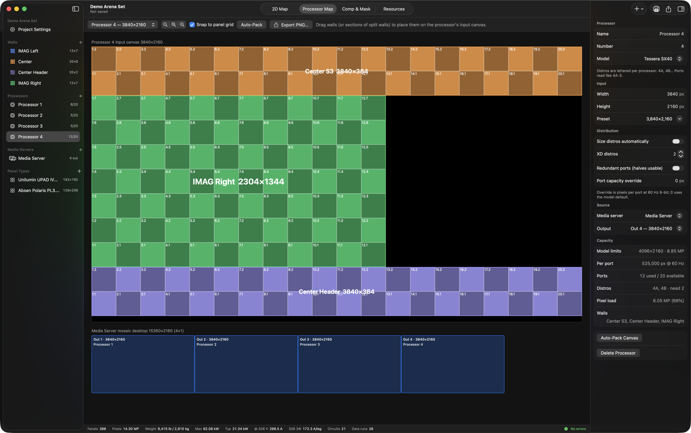
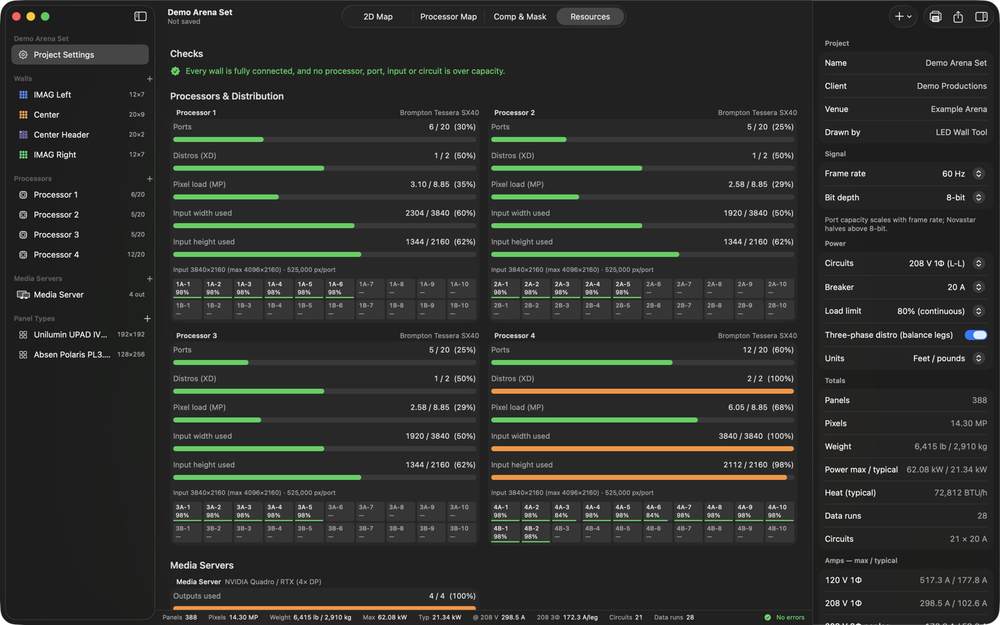

# Processors and Splitting Walls

## Naming

Processors are numbered **1, 2, 3…**. Distribution units are lettered per processor, so processor 1 feeds distros **1A** and **1B**. A data port reads **1A-3**: processor 1, distro A, port 3. Processors without distros (such as Novastar) use **1-P3**.

## Supported processors

| Vendor | Models |
|---|---|
| Brompton | Tessera SX40 with XD distros, S8, S4 |
| Novastar | VX4S, VX6s, NovaPro UHD Jr, COEX MX20, MX30, MX40 Pro |
| Other | Custom (set your own limits) |

For each processor set the input resolution (with presets), the number of XD distros (or let the app size them), redundant ports (halves usable ports), a port capacity override, and which media server output feeds it.

## Splitting a wall across processors

Big walls often need more ports, pixels or input than one processor has. Parts of a wall can go to other processors in any shape.

1. Open the **2D Map**, pick the wall and choose the **Processors** layer.
2. Pick a processor under **Paint with**.
3. Drag across the panels it should drive.

Each processor's panels are tinted their own colour and labelled **S1, S2, S3…**. Dashed lines mark the borders. Paint with the wall's main processor to hand panels back.

Each section:

- gets its own auto-wired runs, so no run crosses between processors
- uses its own processor's port limit and port names (1A-…, 2A-…, 3A-…)
- gets its own spot on that processor's input canvas, placed in the first free space

For a quick even split, use **Split Across Processors** in the wall inspector (left/right into 2–4, or top/bottom into 2–3). Each section then has its own processor, canvas position and **Return to Main Processor** button in the inspector.

You can also right-click a data run in the bottom bar and choose **Move Run to Processor**.

## Processor Map

The **Processor Map** shows one processor's input canvas at a time, with every wall or section placed on it.

- Drag walls to position them. **Snap to panel grid** keeps them on whole panels.
- **Auto-Pack** arranges everything on the canvas, largest first.
- Zoom with the toolbar buttons or pinch. The fit button resets the view.
- **Export PNG…** saves a native-resolution pixel map for content creators.
- Below the canvas, the media server mosaic shows which processor each output feeds.

## Media servers

Add a media server for each playback machine. Set its GPU outputs (resolution and refresh rate) and the mosaic grid, for example four 3840×2160 outputs in a 4×1 mosaic. Each processor then picks the output that feeds it.

## Resources

The **Resources** workspace gathers every check in one place:

- **Checks:** every error and warning. Click one to jump to the wall or processor.
- **Processors & Distribution:** meters for ports, distros, pixel load and input use, plus a grid of every port showing its load.
- **Media Servers:** outputs used and which processors they feed.
- **Walls and power:** size, resolution, weight and power per wall, and amps at every service voltage.
