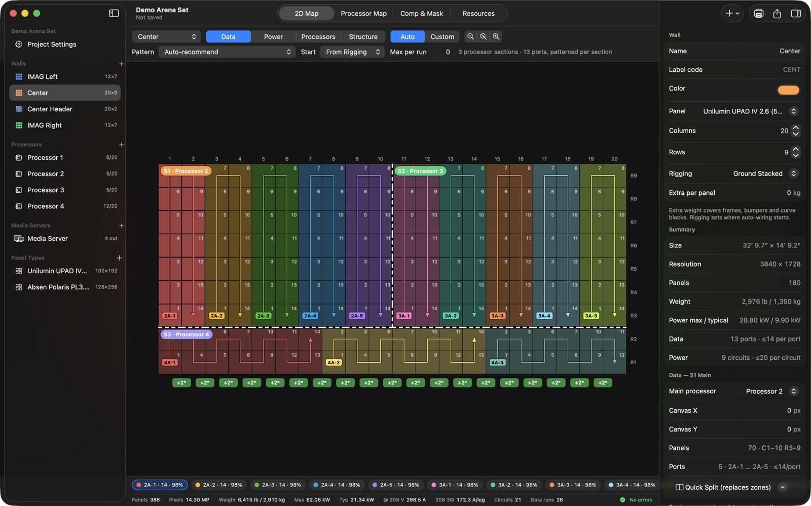
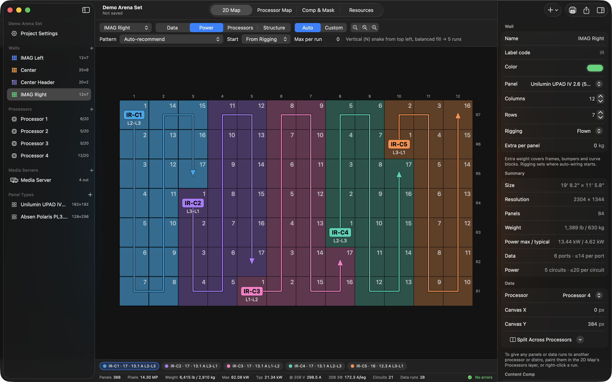

# Data and Power Wiring

Every wall has a data map and a power map. A **run** is one chain of panels: one data port, or one power circuit. Open the **2D Map**, pick a wall in the toolbar and choose the **Data** or **Power** layer.

Each panel shows its position in the chain. The coloured tag marks the first panel (the home run from the port or breaker) and the arrow marks the last. The bar along the bottom lists every run with its panel count and load.

## Auto wiring

With **Auto** selected, runs are generated for you.

| Pattern | Shape |
|---|---|
| Auto-recommend | Tries vertical and horizontal snakes, whole lines and balanced fills, and picks the one with the fewest runs |
| N — Vertical Snake | Up one column, down the next |
| S — Horizontal Snake (Zig-Zag) | Across one row, back along the next |
| Straight Vertical (Up/Down) | Every column runs the same direction |
| Z — Straight Horizontal | Every row runs the same direction |
| U — Vertical, Returns to Start Edge | Pairs of columns, so each run ends where it began |
| C — Horizontal, Returns to Start Side | Pairs of rows, so each run ends where it began |
| Center-Out | Starts at the middle and works outward |

- **Start:** the corner the first run begins at. **From Rigging** starts at the top for flown walls and the bottom for ground-stacked walls.
- **Runs:** keep whole columns or rows on one run, fill each run to the limit, or balance runs to equal length.
- **Max per run:** a lower limit than the processor or circuit allows, for spare capacity. 0 uses the full limit.

## Custom wiring

Choose **Custom** to wire by hand. The current auto runs are copied so you can edit from there.

- **New Run** starts an empty run. Drag across panels to add them in order.
- **⌥-drag** removes panels from runs.
- **Reverse**, **Clear** and **Delete Run** act on the selected run (click a run in the bottom bar).
- **Port** pins the selected data run to a specific port, such as 1B-3. Runs left on **Auto** take the next free port.

Right-click any run in the bottom bar to move it to another processor or, in Custom, pin its port.

## Data limits

The panels-per-port limit comes from the processor's port capacity divided by the panel's pixels:

- Brompton Tessera ports carry 525,000 pixels at 60 Hz. Novastar ports carry 650,000, halved above 8-bit.
- Higher frame rates scale the capacity down (120 Hz carries half as much as 60 Hz).
- A panel type can also set its own **Max panels per data port**.

Each run's load is shown as a percentage of its port.

## Power

Circuits are sized from the project's power settings: voltage × breaker × load limit, divided by the panel's maximum watts. A panel type's **Max panels per power link** also caps a circuit.

- Circuits are labelled with the wall's code and a number, for example **IR-C3**. Set the code in the wall inspector.
- With **Three-phase distro** on, circuits are spread round-robin across the legs (L1-L2, L2-L3, L3-L1 at 208 V) and shown under each home run. The Project Settings inspector shows the load on each leg and a suggested feeder size.
- Power can be auto or custom, just like data.
